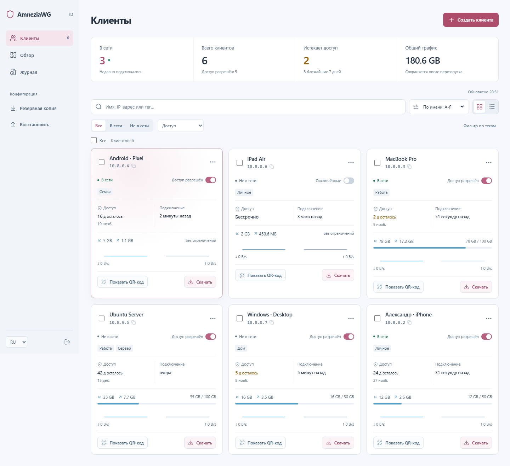

<div align="center">

# AmneziaWG UI

**The easiest way to run AmneziaWG VPN — with an admin panel built for managing and selling access.**

[](https://github.com/w0rng/amnezia-wg-easy)
[](https://github.com/cmtrswtng/amnezia-wg-ui/actions)
[](https://github.com/cmtrswtng/amnezia-wg-ui/pkgs/container/amnezia-wg-ui)
[](./LICENSE)



</div>

## ✨ Features

* 🚀 **All-in-one**: AmneziaWG + Web UI in a single container.
* 🖥️ **Modern dark admin UI** (Vue 3) — fast, clean, mobile-friendly.
* 👥 **Clients**: list, create, edit, delete, enable & disable, QR codes, downloadable configs.
* 🏷️ **Tags** — free-form labels with filtering and autocomplete. Know where each client came from.
* ⏳ **Expiry dates** — configs auto-disable when the time runs out; renew in one click.
* 📊 **Traffic quotas** — «N GB per M days» per client, auto-disable on exceed, new cycle on renewal.
* ✅ **Bulk actions** — extend, tag, enable/disable, reset quota, delete — for many clients at once.
* 📈 **Sales dashboard** — expiring soon, new clients this month, top by traffic.
* 🧾 **Audit log** — who created/changed/disabled what, including automatic cron events.
* 🌍 **20 languages** out of the box.
* 🔗 **One-time links** (optional), **Prometheus metrics**, Tx/Rx charts, Gravatar/DiceBear avatars.

## Requirements

* A host with Docker installed.

## Installation

### One-line installer (recommended)

On any fresh Linux VPS, as root:

```bash
bash <(curl -Ls https://raw.githubusercontent.com/cmtrswtng/amnezia-wg-ui/master/install.sh)
```

The script will:

1. Install Docker (via the official `get.docker.com` script) if it's missing.
2. Auto-detect the server's public IP and ask you to confirm or edit it, then ask for the Web UI and WireGuard ports (defaults `51821` / `51820`).
3. Ask for the admin password twice (hidden input) and generate its bcrypt hash using the Docker image itself — no Node.js needed on the host.
4. Write `/opt/amnezia-wg-ui/.env` (mode `600`) and `/opt/amnezia-wg-ui/docker-compose.yml`.
5. Open `51820/udp` and `51821/tcp` in `ufw` if it's active (otherwise it reminds you to open them in your cloud firewall).
6. Start the container and **verify** that the password actually matches the hash seen by the running container.

When done it prints the Web UI URL (`http://<your-ip>:51821`).

**Updating:** just re-run the same one-liner — it detects the existing installation and offers to pull the latest image. To go through the full setup again (new password, ports, etc.), wipe `/opt/amnezia-wg-ui` first or edit the files there manually and run `docker compose up -d --force-recreate`.

**Files and data:** everything lives in `/opt/amnezia-wg-ui`; clients, keys and the audit log are stored in the `awg_data` Docker volume — `docker compose down` keeps them, `down -v` deletes them.

### 1. Install Docker (manual way)

```bash
curl -sSL https://get.docker.com | sh
sudo usermod -aG docker $(whoami)
exit
```

And log in again.

### 2. Run AmneziaWG UI

```bash
docker run -d \
  --name=amnezia-wg-ui \
  -e LANG=en \
  -e WG_HOST=<🚨YOUR_SERVER_IP> \
  -e PASSWORD_HASH=<🚨YOUR_ADMIN_PASSWORD_HASH> \
  -e PORT=51821 \
  -e WG_PORT=51820 \
  -v ~/.amnezia-wg-ui:/etc/wireguard \
  -p 51820:51820/udp \
  -p 51821:51821/tcp \
  --cap-add=NET_ADMIN \
  --cap-add=SYS_MODULE \
  --sysctl="net.ipv4.conf.all.src_valid_mark=1" \
  --sysctl="net.ipv4.ip_forward=1" \
  --device=/dev/net/tun:/dev/net/tun \
  --restart unless-stopped \
  ghcr.io/cmtrswtng/amnezia-wg-ui
```

> 💡 Replace `YOUR_SERVER_IP` with your WAN IP, or a Dynamic DNS hostname.
>
> 💡 Replace `YOUR_ADMIN_PASSWORD_HASH` with a bcrypt password hash to log in on the Web UI.
> The fastest way to get one — clone this repo and run:
>
> ```bash
> npm --prefix src ci && node src/setup-password.mjs
> ```
>
> It generates a random admin password, writes `PASSWORD_HASH` into your `.env` and prints the password once.
> The classic interactive way also works: `docker run --rm -it ghcr.io/cmtrswtng/amnezia-wg-ui wgpw` —
> see [How_to_generate_an_bcrypt_hash.md](./How_to_generate_an_bcrypt_hash.md).

The Web UI will now be available on `http://0.0.0.0:51821`.

The Prometheus metrics will now be available on `http://0.0.0.0:51821/metrics`. Grafana dashboard [21733](https://grafana.com/grafana/dashboards/21733-wireguard/)

> 💡 Your configuration files will be saved in `~/.amnezia-wg-ui`

### Docker Compose

```bash
git clone https://github.com/cmtrswtng/amnezia-wg-ui.git
cd amnezia-wg-ui
cp .env.example .env  # or create .env manually; at minimum set WG_HOST
node src/setup-password.mjs   # optional but recommended: sets the admin password
docker compose up --build -d
```

## Development

For local development with hot reload, run:

```bash
npm run serve:dev
```

This starts the backend with nodemon (auto-restarts on code changes) and the admin UI
via the Vite dev server on `http://localhost:5173` (hot reload, API proxied to the backend).
The backend API itself is available on `$PORT` (default `51821`).

## Options

These options can be configured by setting environment variables using `-e KEY="VALUE"` in the `docker run` command.

| Env                           | Default           | Example                        | Description                                                                                                                                                                                                        |
|-------------------------------|-------------------|--------------------------------|--------------------------------------------------------------------------------------------------------------------------------------------------------------------------------------------------------------------|
| `PORT`                        | `51821`           | `6789`                         | TCP port for Web UI.                                                                                                                                                                                               |
| `WEBUI_HOST`                  | `0.0.0.0`         | `localhost`                    | IP address web UI binds to.                                                                                                                                                                                        |
| `PASSWORD_HASH`               | -                 | `$2y$05$Ci...`                 | When set, requires a password when logging in to the Web UI. Generate one with `node src/setup-password.mjs`.                                                                                                       |
| `WG_HOST`                     | -                 | `vpn.myserver.com`             | The public hostname of your VPN server.                                                                                                                                                                            |
| `WG_DEVICE`                   | `eth0`            | `ens6f0`                       | Ethernet device the wireguard traffic should be forwarded through.                                                                                                                                                 |
| `WG_PORT`                     | `51820`           | `12345`                        | The public UDP port of your VPN server. WireGuard will listen on that (othwise default) inside the Docker container.                                                                                               |
| `WG_CONFIG_PORT`              | `51820`           | `12345`                        | The UDP port used on [Home Assistant Plugin](https://github.com/adriy-be/homeassistant-addons-jdeath/tree/main/wgeasy)                                                                                             |
| `WG_MTU`                      | `null`            | `1420`                         | The MTU the clients will use. Server uses default WG MTU.                                                                                                                                                          |
| `WG_PERSISTENT_KEEPALIVE`     | `0`               | `25`                           | Value in seconds to keep the "connection" open. If this value is 0, then connections won't be kept alive.                                                                                                          |
| `WG_DEFAULT_ADDRESS`          | `10.8.0.x`        | `10.6.0.x`                     | Clients IP address range.                                                                                                                                                                                          |
| `WG_DEFAULT_DNS`              | `1.1.1.1`         | `8.8.8.8, 8.8.4.4`             | DNS server clients will use. If set to blank value, clients will not use any DNS.                                                                                                                                  |
| `WG_ALLOWED_IPS`              | `0.0.0.0/0, ::/0` | `192.168.15.0/24, 10.0.1.0/24` | Allowed IPs clients will use.                                                                                                                                                                                      |
| `WG_PRE_UP`                   | `...`             | -                              | See [config.js](./src/config.js) for the default value.                                                                                                                                                            |
| `WG_POST_UP`                  | `...`             | `iptables ...`                 | See [config.js](./src/config.js) for the default value.                                                                                                                                                            |
| `WG_PRE_DOWN`                 | `...`             | -                              | See [config.js](./src/config.js) for the default value.                                                                                                                                                            |
| `WG_POST_DOWN`                | `...`             | `iptables ...`                 | See [config.js](./src/config.js) for the default value.                                                                                                                                                            |
| `WG_ENABLE_EXPIRES_TIME`      | -                 | -                              | Deprecated: client expiry is now always enabled.                                                                                                                                                                   |
| `LANG`                        | `en`              | `de`                           | Web UI language (Supports: en, ua, ru, tr, no, pl, fr, de, ca, es, ko, vi, nl, is, pt, chs, cht, it, th, hi).                                                                                                      |
| `UI_TRAFFIC_STATS`            | `false`           | `true`                         | Enable detailed RX / TX client stats in Web UI                                                                                                                                                                     |
| `UI_CHART_TYPE`               | `0`               | `1`                            | UI_CHART_TYPE=0 # Charts disabled, UI_CHART_TYPE=1 # Line chart, UI_CHART_TYPE=2 # Area chart, UI_CHART_TYPE=3 # Bar chart                                                                                         |
| `DICEBEAR_TYPE`               | `false`           | `bottts`                       | see [dicebear styles](https://www.dicebear.com/styles/)                                                                                                                                                            |
| `USE_GRAVATAR`                | `false`           | `true`                         | Use or not GRAVATAR service                                                                                                                                                                                        |
| `WG_ENABLE_ONE_TIME_LINKS`    | `false`           | `true`                         | Enable display and generation of short one time download links (expire after 5 minutes)                                                                                                                            |
| `MAX_AGE`                     | `0`               | `1440`                         | The maximum age of Web UI sessions in minutes. `0` means that the session will exist until the browser is closed.                                                                                                  |
| `UI_ENABLE_SORT_CLIENTS`      | `false`           | `true`                         | Enable UI sort clients by name                                                                                                                                                                                     |
| `ENABLE_PROMETHEUS_METRICS`   | `false`           | `true`                         | Enable Prometheus metrics `http://0.0.0.0:51821/metrics` and `http://0.0.0.0:51821/metrics/json`                                                                                                                   |
| `PROMETHEUS_METRICS_PASSWORD` | -                 | `$2y$05$Ci...`                 | If set, Basic Auth is required when requesting metrics.                                                                                                                                                            |
| `JC`                          | `random`          | `5`                            | Junk packet count — number of packets with random data that are sent before the start of the session.                                                                                                              |
| `JMIN`                        | `50`              | `25`                           | Junk packet minimum size — minimum packet size for Junk packet. That is, all randomly generated packets will have a size no smaller than Jmin.                                                                     |
| `JMAX`                        | `1000`            | `250`                          | Junk packet maximum size — maximum size for Junk packets.                                                                                                                                                          |
| `S1`                          | `random`          | `75`                           | Init packet junk size — the size of random data that will be added to the init packet, the size of which is initially fixed.                                                                                       |
| `S2`                          | `random`          | `75`                           | Response packet junk size — the size of random data that will be added to the response packet, the size of which is initially fixed.                                                                               |
| `H1`                          | `random`          | `1234567891`                   | Init packet magic header — the header of the first byte of the handshake. Must be < uint_max.                                                                                                                      |
| `H2`                          | `random`          | `1234567892`                   | Response packet magic header — header of the first byte of the handshake response. Must be < uint_max.                                                                                                             |
| `H3`                          | `random`          | `1234567893`                   | Underload packet magic header — UnderLoad packet header. Must be < uint_max.                                                                                                                                       |
| `H4`                          | `random`          | `1234567894`                   | Transport packet magic header — header of the packet of the data packet. Must be < uint_max.                                                                                                                       |

> If you change `WG_PORT`, make sure to also change the exposed port.

## Updating

```bash
docker stop amnezia-wg-ui
docker rm amnezia-wg-ui
docker pull ghcr.io/cmtrswtng/amnezia-wg-ui
```

And then run the `docker run -d \ ...` command above again.

## Credits

This project is a fork of [amnezia-wg-easy](https://github.com/w0rng/amnezia-wg-easy) by [@w0rng](https://github.com/w0rng),
which is based on [wg-easy](https://github.com/wg-easy/wg-easy) by Emile Nijssen and uses the AmneziaWG integration
from [amnezia-wg-easy](https://github.com/spcfox/amnezia-wg-easy) by Viktor Yudov.

The fork adds the redesigned admin UI, client tags, traffic quotas, bulk actions, the sales dashboard and the audit log.
